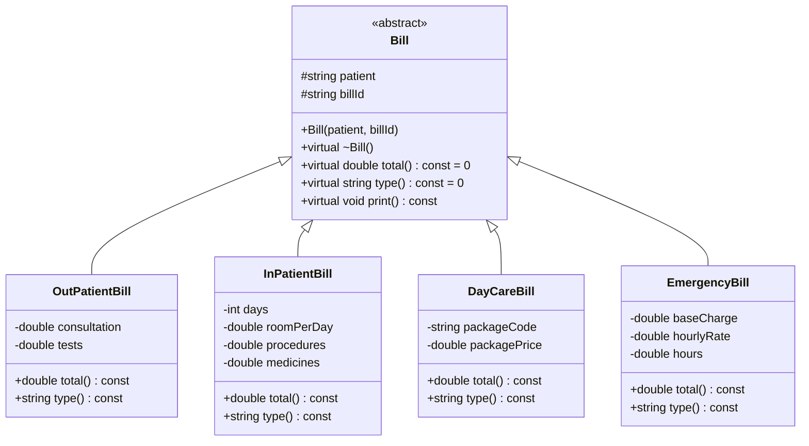

# Task A1 - Polymorphic Bill Hierarchy

## A1.1 Common interface and data
Every bill exposes `total() const`, `type() const`, and `print() const`. The common data are patient identifier/name, bill identifier, date, and optionally a validated patient-record reference. Monetary values are stored as `double` for this teaching exercise; a production billing system should use integer paise or a decimal-money type to avoid binary floating-point rounding.

## A1.2 UML class diagram

`Bill::total` and `Bill::type` are pure virtual. `Bill::~Bill` and `Bill::print` are virtual. Each derived class overrides `total` and `type`. `print` is inherited and calls the virtual operations.

## A1.3 SIMATS-style pseudocode: process a day's bills
```text
ALGORITHM CalculateDayTotal
INPUT: bills[0..n-1], an array of pointers to Bill
OUTPUT: dayTotal

BEGIN
    dayTotal <- 0
    FOR i <- 0 TO n-1 DO
        IF bills[i] IS NOT NULL THEN
            dayTotal <- dayTotal + bills[i].total()
        END IF
    END FOR
    RETURN dayTotal
END
```

## Alternative: tagged structure and switch
A single `BillRecord` would contain a `BillKind` enum plus fields for every type (or a tagged union). `total(record)` switches on the tag and computes the matching formula. Both strategies process `n` bills in O(n) time. A virtual design has one dispatch per bill and stores a vptr in each polymorphic object; the tagged design has a tag and storage for the largest record/union alternative. Adding a new type requires adding a new derived class in the virtual design without changing the loop, whereas the switch design generally requires changing the enum, record layout and every relevant switch. The tagged representation may have better locality; virtual calls offer open extension and independent implementations.