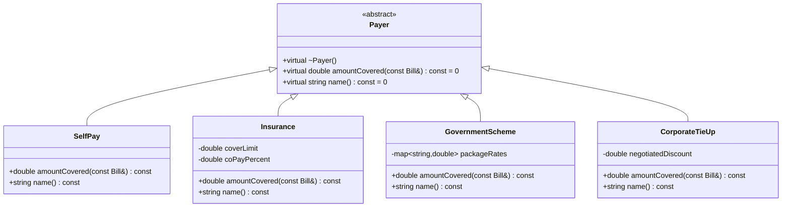

# Task A3 - Abstract Payer Design

`Payer` is an abstract interface. `SelfPay` covers the full valid bill. `Insurance` applies a configured policy: the insurer covers at most the policy limit, after deducting the patient's co-payment share. For bill amount B, cover limit L, co-payment fraction p: `min(B*(1-p), L)`. `GovernmentScheme` uses a known package code and returns its fixed package reimbursement, capped at the billed amount; an unknown code throws `UnknownPackageError`.

A corporate tie-up is added by creating a new `CorporateTieUp : Payer` class and implementing the two virtual functions. Existing payer classes and bill processing loops are unchanged (Open/Closed Principle).

## Alternative: function pointer / std::function
A policy can be represented by `std::function<double(const Bill&)>`, with the callable capturing configuration such as limit and co-payment. Invocation is O(1) in the abstract complexity model, as is a virtual function call. A `std::function` may require a type-erasure manager and possibly heap storage for large captures; a plain function pointer cannot own per-policy state unless state is passed separately. The class approach keeps policy data and behaviour together in a typed object; callables are compact for simple policies but can make validation and configuration less explicit.